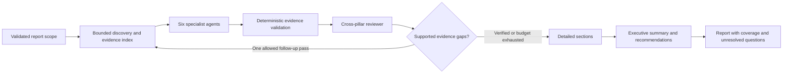

# Evidence-driven discovery and six-pillar diagnosis

## Intent and scope

The owner requested model-appropriate prompts, a bounded diagnosis loop separated
from specialist agents, and fuller use of discovery. Their concrete failure is
missing instance-to-database relationships and insufficient right sizing analysis.

Deliver source, tests and runtime configuration. Deployment, paid model probes,
infrastructure mutation and image publication remain outside the authorized scope.
Preserve ADR-005, all existing connector controls, account ownership, feature
gates, report lineage, deterministic invariant verdicts and release ordering.

## Current gaps

- `diagnosis/sources.py` collects a fixed source list. It does not consume the
  stored topology graphs or Compute Optimizer findings.
- `collect_service_map` reads the first X-Ray page in one region over three hours.
  Service names are display hints; they do not establish AWS resource identity.
- `collect_cw_metrics` reads up to 50 host instances, using three hours of hourly
  average CPU. The DB section receives that EC2-only source. This cannot justify
  a specific DB class change or a safe EC2 downsize.
- Inventory sampling can omit the resources needed to connect an application
  instance to its database. The model receives no explicit dependency coverage.
- Existing trace parsing retains service/account/region and DB peer metadata,
  but no EC2 host/resource identity. Reading the graph alone therefore cannot
  establish service-to-instance binding.
- Executive summary, detailed sections and recommendations run concurrently.
  Their conclusions are independent rather than verified and then synthesized.
- Runtime network prompts name an absent tool, `analyze_reachability`, and describe
  `query_flow_logs` as traffic evidence although it lists flow-log configuration.
  The cost prompt omits the existing Compute Optimizer tool.

## Execution architecture

Keep the Fargate report worker as the orchestrator. It owns account scope, deadlines,
discovery execution, evidence admission, stage ordering and final report assembly.
The six agents are constrained model calls with distinct pillar instructions and
structured results; they do not receive general SDK clients, arbitrary SQL,
external URLs, credentials or mutating tools.

The discovery planner is code-owned. Model requests may choose only named
capabilities and already-admitted resource identities. Validate scope and bounds
before dispatch. Unknown capabilities, region changes, cross-account substitutions,
arbitrary query text and ungoverned MCP connections are rejected.

Initial live AWS collection is host-only. Member reports may use their own scoped
inventory and configuration graph; host credentials, external trace graphs and
host-region FinOps findings are never substituted. Member live metrics/provider
reads are explicitly unsupported, not permission failures and not healthy passes.
Adding a member-role execution path is outside this implementation.

Do not enable the dark Anthropic chat loop or route normal chat through this
report loop. Correct existing runtime prompt/tool descriptions separately.

## Discovery and connection evidence

Build a bounded, normalized dependency bundle before analysis:

1. Read inventory with account and region preserved. Prefer compute/database
   resource details and relationship endpoints over unrelated samples.
   Use scoped identity `(account, region, kind, resource_id)`; labels, tags,
   private IPs and names alone never establish globally unique identity.
2. Read existing `flow`, `infra` and `trace` graphs for the same permitted scope.
   Reuse graph-state freshness and source provenance rules. Project metadata with
   an explicit allowlist; never pass raw `meta.row`, SQL rows, logs or trace bodies.
   Member reports cannot consume the host's external trace graph as member data.
3. Paginate X-Ray within region/page/node/edge/deadline limits. Preserve reference
   IDs across pages and expose unresolved targets. Keep time-window, sampling,
   continuation and capture metadata. A missing edge never proves no dependency.
4. Extend the existing trace adapter with narrowly allowlisted
   `cloud.resource_id`, `host.id` and `service.instance.id` metadata. Treat these
   as claims, validate AWS ARN/instance-ID shape and exact account/region
   participation, and join only a unique matching inventory EC2 resource.
   Retain the binding's evidence and freshness in projected graph metadata.
   No raw resource-attribute map enters model context. Existing graph JSON
   storage can carry these additions without a database migration.
5. Correlate verified instance bindings with the trace's DB endpoint and an exact,
   unique scoped inventory endpoint match. The observed chain becomes
   instance → service → DB, with every hop's evidence preserved. Bind the source
   instance and DB peer within the same span/trace evidence or a preserved
   service-instance-scoped observation. Never combine aggregate service bindings
   with aggregate DB edges or fan out a service dependency to every instance.
   Preserve opaque correlation IDs or explicit observed pairs in projected
   graph metadata; raw trace bodies are unnecessary. When source
   binding is missing or ambiguous, report service → DB and keep the instance
   unknown. Do not make DNS/network probes or enumerate application environment
   variables to obtain connection strings.
6. Follow up at most once using validated, existing resources and read-only
   capabilities. Additional DB detail, metrics or the next permitted graph page
   may resolve a gap; unknown scope stays unknown.

Every edge has an evidence kind:

| Kind | Meaning | Permitted conclusion |
| --- | --- | --- |
| Observed call | Fresh trace with trustworthy scoped endpoint identities | This dependency was observed in the stated sample/window |
| Observed network flow | Fresh scoped packet/connection telemetry | Traffic was observed; DB session, query success and causality remain unproven |
| Configured dependency | Explicit inventory/configuration relationship | A relationship is configured; traffic is unverified |
| Allowed path | SG/NACL/routing permits the path | Connectivity may be possible; an application dependency is unverified |
| Candidate | Ambiguous name, address, tag or incomplete join | Needs corroboration; exclude from confirmed dependency counts |

A shared SG, VPC, subnet, tag or an open database port is not an actual
instance-to-DB connection. Positive network traffic is not proof of successful SQL.
Retained/stale graph rows are historical context, not current healthy connectivity.

Builder-selected initial limits: eight existing inventory regions, three X-Ray
pages per region, 200 normalized resources, 400 relationships and 192 KiB of
discovery context. Preserve total/matched/returned/omitted counts, region coverage
and unresolved identities. Caps mark incomplete coverage, never complete absence.
Prioritize directly related EC2/RDS endpoints; disclose any omitted components.

## Right sizing evidence

Use existing persisted FinOps findings where their scope, provenance, timestamps,
lookback and guard state can be established. Supplement them with explicitly
gated read-only Compute Optimizer EC2/RDS reads when authorized by the applied
worker configuration. Do not activate the FinOps feature merely to gain access.

Collect scoped EC2 and RDS metrics for a representative 14-day window using the
existing CloudWatch read capability. Include peak/p95 CPU, sample coverage,
network or I/O pressure, and RDS free memory, connections, read/write latency,
queue depth and replica/HA context when available. EC2 memory is unavailable
unless a verified existing metric supplies it; do not invent an agent namespace.
Use actual RDS metric dimensions and region, not EC2 instance IDs.
CloudWatch namespace discovery must omit an absent optional `MetricName` rather
than send `None`. Align the registered tool schemas with supported dimensions,
statistic and bounded window inputs, and test these against botocore shapes.

Preserve provider recommendation class/type, generation time, lookback,
performance risk, missing utilization metrics, projection and savings currency.
Use the lowest-ranked provider option according to the API contract. Currency
and scope must match before aggregation. Service-level Cost Explorer spend is
not instance-level spend, and partial-month costs are not full monthly savings.

| Evidence | Allowed output |
| --- | --- |
| Fresh scoped provider recommendation plus adequate lookback and no veto | Named provider candidate, evidence, risk, prerequisites and manual verification |
| Only short CPU sample, missing memory/I/O, stale provider data, or <14-day lookback | Investigation candidate; no definitive safe downsize or fabricated target/savings |
| Missing DB utilization or unverified application dependency | Explicit gap and targeted read-only verification |

A recommendation remains a proposal. Check dependency pressure, correlated
application/DB bottlenecks, HA/replica role and protected-resource guards before
describing feasibility. Low average CPU does not prove spare memory, I/O or
connection capacity. No recommendation is automatically applied.

## Model and prompt design

Retain the configured Sonnet/Opus model IDs and existing tier policy. Verify
model-specific parameters against official Bedrock documentation. Do not infer
capabilities from a model-name substring alone or invent model versions.

For verified current models, use adaptive reasoning with bounded effort for
specialist analysis and review. Presentation uses deterministic formatting.
Keep reasoning private. Return concise conclusions, cited evidence,
uncertainty and next verification steps instead of chain-of-thought.

Use stable, compact JSON schemas with `additionalProperties: false` throughout,
the documented `output_config.format` field, and local semantic validation.
Unsupported model overrides must produce visible bounded degradation rather
than silently dropping validation. Account for initial grammar compilation in
the existing request and task deadlines. Truncated JSON is failed evidence.

Separate trusted task instructions from untrusted source data. Escape or serialize
delimiters, redact before every model call, and preserve the existing read-only
CLI/output guards. No instruction found in inventory, labels or telemetry may
select tools, change scope or override policy.

Each specialist produces a limited set of findings with:

- Stable finding ID, pillar, severity, affected scoped resource IDs and summary.
- Evidence references into a code-owned index, including source, field/value,
  capture/window and coverage. Unknown references are rejected.
- Confirmed observation versus hypothesis, confidence and unresolved prerequisites.
- Read-only verification and a manual remediation proposal.
- Dependency and right sizing guard results where relevant.

Reject out-of-scope targets, fabricated citations, mismatched values, unsupported
numeric savings and claimed observed edges backed only by configuration. A valid
JSON response is not proof of a valid diagnosis.

| Specialist | Focus |
| --- | --- |
| Operational Excellence | Discovery/telemetry coverage, actionable alerts, changes and diagnosis gaps |
| Security | Exposure, identity and protection, with allowed paths distinguished from traffic |
| Reliability | Verified dependencies, HA/replicas, correlated failure and explicitly unknown topology |
| Performance Efficiency | EC2/DB pressure, peak/load coverage, bottlenecks and sizing prerequisites |
| Cost Optimization | Provider sizing candidates, idle spend, commitments and non-overlapping savings |
| Sustainability | Resource-efficiency opportunities; no fabricated carbon figures or score |

The reviewer identifies contradiction, duplicate savings, unsupported cause,
wrong scope, stale evidence and missing dependency/sizing prerequisites. Its
references are validated too. It can request only an allowlisted evidence gap,
not new actions. Invalid findings are withheld or downgraded visibly.

Existing UI section keys, localized titles, 9/16-section progress contracts and
deterministic Intended vs Actual rendering remain intact. Detailed sections
consume only validated findings and their declared evidence. Executive summary
and recommendations run last and cannot introduce a new target, amount or risk.
Do not fabricate a 100-point health score from incomplete pillar evidence.

Enabled-mode presentation is code-owned, not the existing free Markdown renderer.
Models return structured finding/claim selections and explanations. Code renders
resource IDs, metric values, units, amounts, scope, windows and evidence from the
admitted records into localized tables. Executive summary/recommendations select
existing finding IDs only; title/tags use the highest-priority admitted finding
and controlled pillar tags. Do not run a separate free-text title model in this
mode. Explanations are labeled hypotheses unless a deterministic claim check
establishes the stated observation; a reviewer cannot promote a hypothesis to
confirmed causality merely because a citation exists. Controlled verification
templates supply read-only operations instead of executing model-generated CLI.

## Budgets, rollout and failure semantics

Add `diagnosis_evidence_loop_enabled`, default false, with worker-only configuration.
No request payload can turn it on. The disabled path preserves existing execution.
The enabled path is read-only analysis; it grants no mutation/autonomy exception.

Builder-selected initial limits: one analysis pass for light, at most two for
mid/deep; six initial specialists, one reviewer and at most two targeted
specialist follow-ups plus one final review. Concurrency stays at most four.
Deduplicate identical evidence requests and stop on no progress, exhausted
scope/call/byte/time budget or sufficient supported evidence.

Use one report deadline bounded by the existing 3,600-second task budget, with
the existing 3,300-second worker budget and 600-second artifact/export reserve.
The handler owns a thread-safe budget from entry through title/tag completion,
passes it into collection/analysis/rendering, and records its final state.
Count all model HTTP attempts, including
retries; stop before the shared ceiling (20 light, 24 mid, 32 deep). Reserve
capacity for the final structured review; presentation and title selection are
local operations.
Surface budget exhaustion and uncompleted pillars. No unbounded threads,
looping synthesis, repeated empty discovery or paid live test is authorized.

The enabled mode uses no additional presentation/title inference calls.
Initial request bounds are 96 KiB of serialized input per call, 2/3/4 MiB of
total submitted input for light/mid/deep, 8,192 output-plus-thinking tokens per
call, and 100,000/120,000/200,000 reserved output-plus-thinking tokens per report.
Charge requested maximum tokens before every attempt, including failed/retried
attempts, so unknown usage cannot circumvent the bound. Measure response usage
separately; these allocation caps are not a dollar-cost estimate.

Summary JSON may add discovery, pillar coverage, rejected-finding and budget
metadata. Keep existing `degraded`, `incomplete`, `render_degraded`, lineage and
notification semantics. Missing permissions, stale/ambiguous dependencies,
unavailable provider recommendations and failed model stages remain visible;
none become a healthy pass. No schema migration is required for additive JSON.
Record actual model ID, prompt/schema version, input/output usage when supplied,
attempt counts and stage outcomes. Missing usage is unknown, never zero.
Do not claim a dollar budget is enforced by a call ceiling.

## Implementation seams

| Area | Responsibility |
| --- | --- |
| `web/lib/trace-source.ts`, `trace-graph.ts`, trace identity/projection tests | Allowlisted EC2 identity claims, unique scoped inventory binding, preserved provenance |
| `scripts/v2/workers/diagnosis/sources.py` and new discovery/evidence helpers | Typed source capabilities, scoped graph/inventory/metric/provider reads, caps and evidence index |
| `scripts/v2/workers/diagnosis/sections.py` and new pillar agents/loop helpers | Six role prompts, structured findings, semantic admission, cross-review and targeted follow-up |
| `scripts/v2/workers/diagnosis/report.py` | Disabled-path compatibility, shared deadlines/budgets, stage ordering, final synthesis and additive summary |
| `agent/agent.py`, `agent/lambda/aws_cloudwatch_mcp.py`, provisioner catalog | Correct existing read-only tool names/semantics and metric discovery schema; no new unrestricted gateway |
| `terraform/foundation/variables.tf`, `workers.tf` and provider-mock tests | Default-off flag, applied worker-only configuration and the two guarded Compute Optimizer read actions |
| Diagnosis evaluation fixtures and developer documentation | Connection/sizing quality criteria, coverage limitations and rollout evidence |

## Verification and acceptance

Use offline provider/model fixtures and disposable PostgreSQL where appropriate:

1. Resolve an EC2-to-RDS observed dependency with exact identities and preserve
   the full evidence chain into performance/cost findings and final synthesis.
   For two instances of one service with A → DB1 and B → DB2, never invent
   A → DB2 or B → DB1 from aggregated service edges.
2. With only a shared SG, same name in another region, stale graph or failed
   member read, show an unverified candidate and never substitute host evidence.
3. Cover X-Ray references on later pages, empty/partial pages, repeated tokens,
   identity collision, missing graph state and every discovery cap.
4. Produce a guarded provider sizing candidate with fresh representative metrics.
   Short CPU-only data, missing DB dimensions, low lookback, protected tags,
   mixed currencies and missing memory must withhold definitive downsizing.
5. Reject fabricated citations, altered values, injected instructions, invalid
   JSON, truncation, duplicate savings and summary claims absent from findings.
6. Verify stage ordering, selective follow-up, no-progress stop, concurrency,
   all-attempt budgets, deadlines, partial reports and unchanged disabled path.
7. Preserve all report locales, UI/catalog contracts, invariant verdicts,
   ownership and read-only commands. Check Terraform default-off gating/IAM
   using isolated provider mocks; do not apply.

Update the diagnosis evaluation guide with deterministic quality criteria and
representative fixtures. No offline result establishes real deployed discovery,
model quality or successful live AWS access.

## Official references

- [Claude Sonnet 5.5 model capabilities](https://docs.aws.amazon.com/bedrock/latest/userguide/model-card-anthropic-claude-sonnet-5-5.html)
- [Adaptive thinking](https://docs.aws.amazon.com/bedrock/latest/userguide/claude-messages-adaptive-thinking.html)
- [Structured outputs and schema limits](https://docs.aws.amazon.com/bedrock/latest/userguide/structured-output.html)
- [Compute Optimizer metrics and lookback](https://docs.aws.amazon.com/compute-optimizer/latest/ug/metrics.html)
